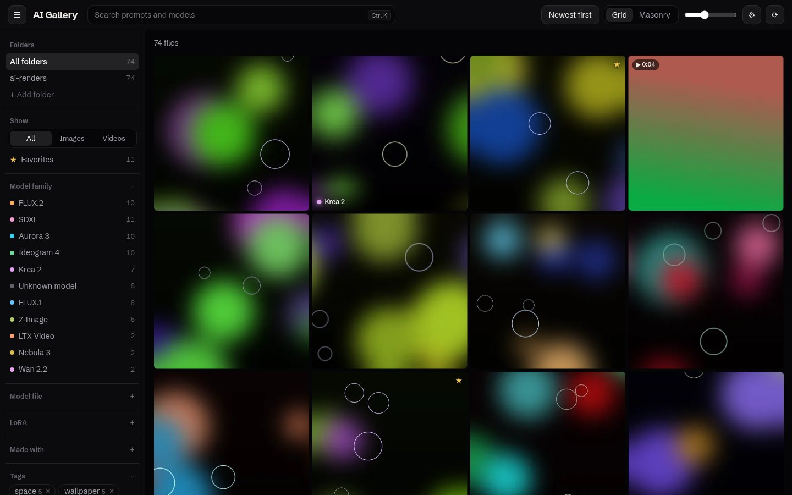
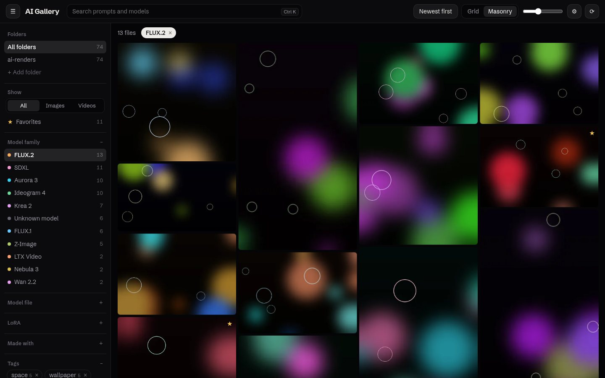
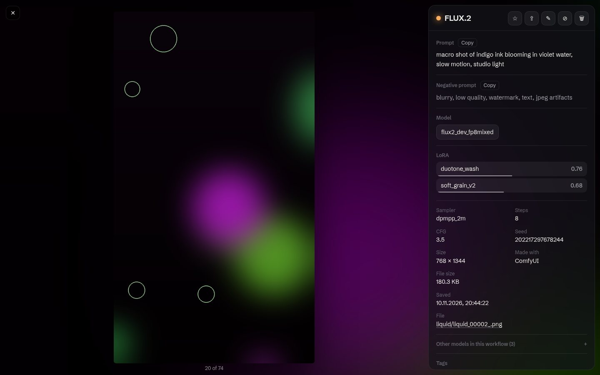
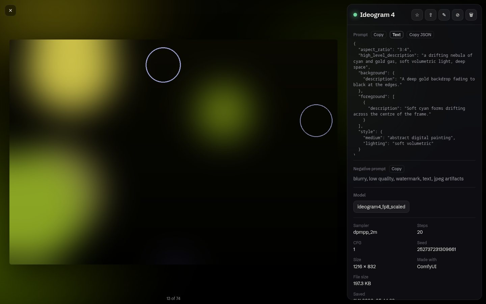
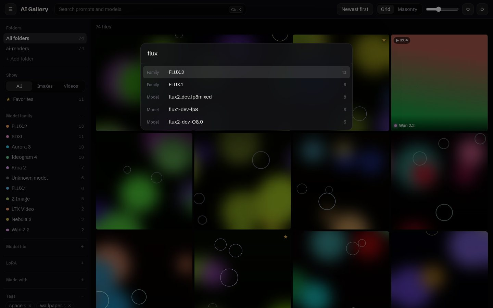
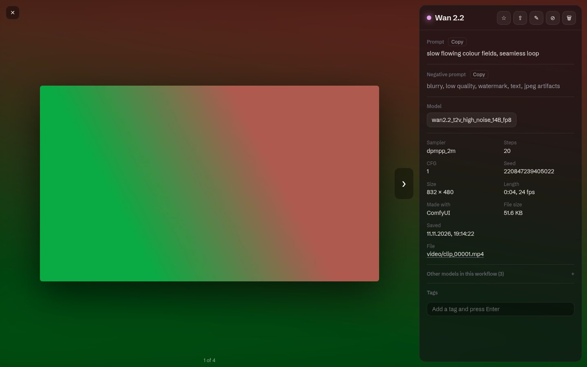
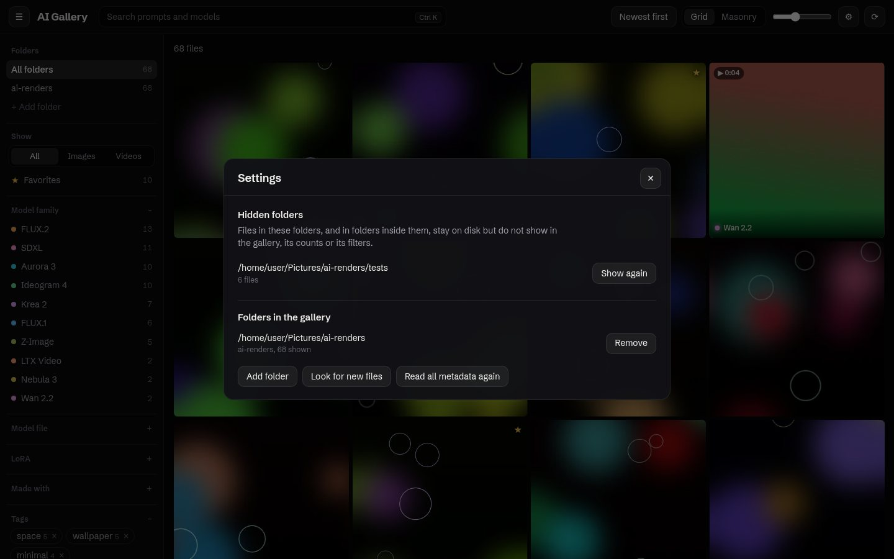
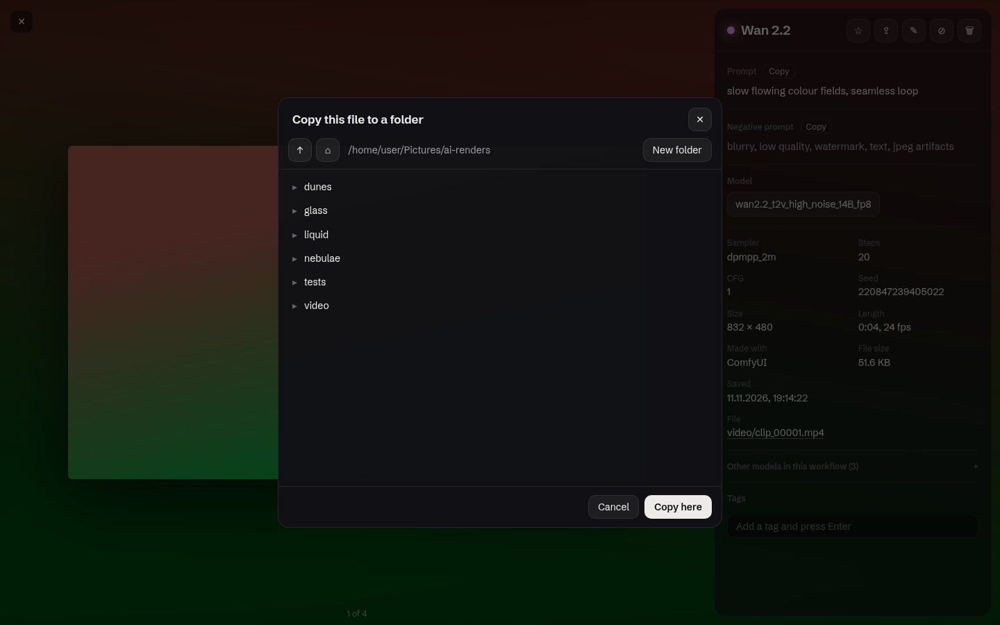

# AI Gallery 2.0

A local, private gallery for AI-generated images and videos. Point it at the
folders your tools write to and it reads the prompt, model, LoRAs and sampler
settings straight out of each file, groups everything by model family, and
keeps the view up to date while you generate.

Nothing leaves your machine: there is no account, no cloud and no telemetry.



*All screenshots show a synthetic demo library made by
`tools/make_demo.py` — procedural shapes with invented metadata, no real
generations.*

## Contents

- [What it does](#what-it-does)
- [Install and run](#install-and-run)
- [Using the gallery](#using-the-gallery)
- [How detection works](#how-detection-works)
- [Video](#video)
- [Hidden folders and settings](#hidden-folders-and-settings)
- [File operations](#file-operations)
- [Keyboard shortcuts](#keyboard-shortcuts)
- [Security model](#security-model)
- [Architecture](#architecture)
- [HTTP API](#http-api)
- [Development](#development)

## What it does

- **Reads metadata from the files themselves.** ComfyUI graphs and
  workflows, A1111 / Forge parameters, EXIF, and metadata written by tools
  the gallery has never seen.
- **Finds the model and LoRAs without a list of known nodes.** A new custom
  loader works the day it appears.
- **Groups by model family** (FLUX.1, FLUX.2, Ideogram 4, Krea 2, Wan 2.2,
  SDXL…) and **learns new families by itself** from unfamiliar file names.
- **Handles video** (`mp4`, `webm`, `mov`, `mkv`, `m4v`) next to images
  (`png`, `jpg`, `webp`, `gif`).
- **Stays live.** A file watcher adds new renders within about half a second.
- **Filters and search.** By folder, type, family, model file, LoRA, tool,
  tag and favorites, plus full-text search over prompts.
- **Safe file operations.** Trash (restorable), rename, copy to a folder —
  each one logged.
- **Fast with large libraries.** The grid is virtualised; tens of thousands
  of files scroll smoothly.

## Install and run

Requirements:

- Linux, macOS or Windows with Python 3.12
- [`uv`](https://docs.astral.sh/uv/) (creates the virtual environment)
- `ffmpeg` and `ffprobe` on `PATH` — only needed for video

```bash
git clone https://github.com/quzopl/ai-gallery-v2.git
cd ai-gallery-v2
./run.sh          # serves http://127.0.0.1:8924
```

`./launch.sh` starts the server and opens the browser; if the server is
already running it only opens the browser. It is a convenient target for a
desktop shortcut.

The first run creates `.venv` and installs the Python dependencies. The built
interface is committed in `frontend/dist`, so Node is not needed to run the
app.

| Setting | Default | Meaning |
|---|---|---|
| `PORT` | `8924` | Port used by `run.sh` / `launch.sh` |
| `AI_GALLERY_WORK_DIR` | `./.work` | Database and thumbnail cache |
| `AI_GALLERY_ALLOWED_HOSTS` | *(empty)* | Extra host names allowed to reach the API, comma-separated (see [Security model](#security-model)) |

To try the app without your own files:

```bash
.venv/bin/python tools/make_demo.py ~/ai-gallery-demo
```

then add `~/ai-gallery-demo` as a folder in the gallery.

## Using the gallery

### Add a folder

Choose **Add folder** in the sidebar, browse to the folder and confirm. The
gallery scans it (subfolders included), then keeps watching it for changes.
Your files are never moved or modified by scanning.

### Browse and filter

The sidebar lists what was found, with counts. Click any row to filter;
click it again to remove the filter. Active filters appear as chips above the
grid.



- **Folders** — one library or all of them
- **Show** — everything, images only, videos only, favorites
- **Model family** — coloured dot per family; the same colour marks tiles
- **Model file** and **LoRA** — exact files, with a search box
- **Made with** — the tool that wrote the file
- **Tags** — your own labels; several tags narrow the result together

The top bar has prompt search, ordering (newest or oldest first), the square
grid / masonry switch, tile size, settings and rescan.

### Open a file

Click a tile. The picture grows into a full-screen viewer and the panel on
the right shows everything read from the file.



- **Model family** (panel title), **model file** and each **LoRA** are
  clickable: they close the viewer and filter the gallery to that value.
- **Prompt** and **negative prompt** have copy buttons. Clicking the seed
  copies it.
- **Other models in this workflow** lists the VAE, text encoders,
  upscalers and similar files.
- Click the picture to zoom to full resolution; click again to fit.
- The buttons at the top: favorite, copy to a folder, rename, hide this
  folder, move to trash.

### Prompts stored as JSON

Some models (Ideogram 4, for example) take a structured JSON caption. The
gallery keeps both forms: a readable text version, which is also what search
uses, and the original JSON. Switch with the **JSON / Text** button; each
form has its own copy button.



### Command palette

`Ctrl+K` opens a palette that searches families, model files, LoRAs, tags
and actions at once. Pressing Enter on plain text searches prompts for it.



### Tags and favorites

Add tags in the viewer (type and press Enter); remove one with its ×. Tags
appear in the sidebar with counts and can be deleted everywhere from there.
`F` toggles the favorite star.

## How detection works

Implemented in [`backend/detect.py`](backend/detect.py) and
[`backend/metadata.py`](backend/metadata.py).

### 1. Collect every text field

- PNG text chunks (`prompt`, `workflow`, `parameters`, and any other key)
- EXIF strings, including the `prompt:{…}` / `workflow:{…}` values that
  ComfyUI's WebP and JPEG savers put in EXIF tags, and `UserComment`
- Container tags of video files, including the JSON `comment` written by
  VideoHelperSuite

### 2. Pick a reader

| Found in the file | Reader |
|---|---|
| `ai_gallery_meta` chunk (companion ComfyUI node) | used first; gaps are filled from the graph |
| ComfyUI execution graph or UI workflow | graph tracer |
| `parameters`, or `UserComment` containing `Steps:` | A1111 / Forge parser |
| anything else | generic reader for unknown tools |

### 3. Find the model and LoRAs without knowing the nodes

Instead of a table of loader classes, every string in the graph that is a
model file (`.safetensors`, `.gguf`, `.ckpt`, `.pt`, `.pth`, `.sft`, `.bin`,
`.onnx`) is collected and given a role from the input name, node class and
path around it:

| Role | Typical signals |
|---|---|
| model | `unet_name`, `ckpt_name`, `model`, `gguf_name`; classes mentioning checkpoint / unet / model loader |
| LoRA | "lora" in the input name, node class or path |
| VAE | "vae" in the name; `ae.safetensors` |
| text encoder | `clip_name*`; names such as `t5xxl`, `clip_l`, `umt5` |
| upscaler, ControlNet, CLIP vision, other helpers | matching names |

The **main model** is the file loaded by the node that feeds the sampler,
found by walking the `model` connections upstream — so the loader's class
name does not matter, and an upscaler or a refiner earlier in the graph is
not mistaken for it. LoRA weights are read from the neighbouring strength
field; entries switched off in a stack are skipped. Bypassed and muted nodes
of UI-only workflows are ignored.

The prompt tracer follows the sampler's positive and negative inputs through
switches, concatenation nodes, primitives and cached text displays, so
prompts built from several nodes or produced by an LLM node are recovered
where the file contains them.

### 4. Files from unknown tools

When no known format matches, the generic reader walks any JSON it finds by
key names (`prompt`, `negative_prompt`, `model`, `base_model`, `seed`,
`steps`, `cfg_scale`, `loras`, …) and scans plain text for patterns such as
`Model: name` and `<lora:name:0.8>`. The tool name is taken from recognisable
keys (InvokeAI, SwarmUI, Fooocus, NovelAI, …) or the `Software` field;
otherwise the file is labelled **Unknown tool**. Such files are listed and
filtered exactly like the rest.

### 5. Model families that learn

The family is derived from the model file name:

| File name | Family |
|---|---|
| `flux1DevFp8_v10.safetensors` | FLUX.1 |
| `flux2_dev_fp8mixed.safetensors`, `flux-2-klein-base-9b.safetensors` | FLUX.2 |
| `ideogram4_unconditional_fp8_scaled.safetensors` | Ideogram 4 |
| `krea2TurboFP8_krea2TURBO.safetensors` | Krea 2 |
| `Wan2_1-T2V-14B_fp8.safetensors` | Wan 2.1 |
| `juggernautXL_v9.safetensors` | SDXL |

A set of well-known stems is built in. When a name matches none of them, the
first meaningful word of the file name becomes a **new stem**, saved in the
database and from then on recognised inside any later file name — so
`Nebula3_dev_fp8` creates "Nebula 3", and `custom_merge_nebula3_turbo` joins
it. A digit right after the stem becomes the version.

After updating the app, Shift+click ⟳ (or **Read all metadata again** in
Settings, or `python reparse.py --force`) re-reads every file with the
current rules.

## Video

Videos are indexed like images. Size, duration and frame rate come from
`ffprobe`; the thumbnail is a frame taken by `ffmpeg`. In the grid a video
shows its length and plays muted while the pointer is over it; the viewer has
a normal player.



Metadata is read from the container tags, which is where ComfyUI's SaveVideo
(`prompt` and `workflow` tags) and VideoHelperSuite (JSON `comment`) store
it. A video with no tags is still shown, without a prompt or model.

## Hidden folders and settings

Test renders or a scratch folder do not have to clutter the gallery. Open any
file from that folder and press **⊘ Hide this folder**. The folder and
everything inside it disappears from the grid, the counts and the filters.
The files stay on disk and in the index.

Settings (⚙ in the top bar) lists the hidden folders with a **Show again**
button, and manages the folders in the gallery: add, remove, look for new
files, read all metadata again.



A folder is hidden by its path on disk, so it is hidden everywhere even when
two libraries overlap.

## File operations

| Action | What happens |
|---|---|
| Move to trash | The file goes to the XDG Trash and can be restored from your file manager |
| Rename | In place; names with path separators are rejected |
| Copy to a folder | A copy is written to the folder you pick; the original stays. A name clash gets a `.1`, `.2`… suffix. The last folder is remembered |
| New folder | Available inside the folder picker |



Every operation, successful or not, is recorded and available from
`GET /api/audit`.

## Keyboard shortcuts

| Key | Action |
|---|---|
| `Ctrl+K` | Command palette |
| `/` | Focus prompt search |
| Arrow keys, `PageUp`, `PageDown`, `Home` | Move through the grid |
| `Enter` | Open the focused file |
| `←` `→` | Previous / next file in the viewer |
| `Esc` | Close the viewer, palette or dialog |
| `F` | Favorite |
| `Del` | Move to trash |
| `Ctrl+E` | Copy the file to a folder |
| `Ctrl+C` | Copy the prompt |
| `Ctrl+-` / `Ctrl+=` | Smaller / larger tiles |

## Security model

The server can read and write local files, so it only accepts requests from
your own machine:

- It listens on `127.0.0.1`.
- Requests with a foreign `Host` header are refused, which stops DNS
  rebinding.
- Writes and WebSocket connections coming from another origin are refused,
  which stops other web pages from driving the API.
- Symlinks are not indexed, and a file is served only if it resolves inside
  its library.

To open the gallery from another device, list that host name in
`AI_GALLERY_ALLOWED_HOSTS` and bind the server to a reachable address
yourself. There is no login, so only do this on a network you trust.

## Architecture

```
backend/
  server.py     FastAPI app: REST API, WebSocket, static files
  scanner.py    full scan + watchdog observer per folder (500 ms debounce)
  metadata.py   readers: ComfyUI, A1111, video tags, unknown tools
  detect.py     model-file scan, roles, model families
  db.py         SQLite (WAL, FTS5), single writer thread
  thumbs.py     WebP thumbnails (Pillow, ffmpeg for video)
  fileops.py    trash, rename, move, copy
frontend/
  src/          Svelte 5 components
  dist/         built interface served by the backend
tools/make_demo.py   synthetic demo library
reparse.py           re-read all metadata without the server
tests/               pytest suite
```

- **Storage:** one SQLite file in the work directory. All writes go through
  a single writer thread; reads open their own connections.
- **Search:** SQLite FTS5 over prompt, negative prompt and model name.
- **Thumbnails:** generated on first request, cached by file hash, orphans
  removed on startup and rescan.
- **Live updates:** the backend pushes scan progress and file changes over a
  WebSocket; the interface merges new files into the grid.
- **Interface:** Svelte 5 with Vite. The grid computes its own layout and
  renders only the tiles near the viewport. The tile-to-viewer move uses the
  View Transitions API where the browser has it.

## HTTP API

| Method | Path | Purpose |
|---|---|---|
| `GET` | `/api/libraries` | Folders in the gallery with visible file counts |
| `POST` | `/api/libraries` | `{path, name?}` — add a folder and start scanning |
| `DELETE` | `/api/libraries/{id}` | Remove a folder from the gallery (files untouched) |
| `POST` | `/api/libraries/{id}/rescan` | Rescan; `?force=true` re-reads all metadata |
| `GET` | `/api/images` | List with `library_id`, `q`, `family`, `model`, `lora`, `source`, `kind`, `favorite`, `tag`, `sort`, `cursor`, `limit` |
| `GET` | `/api/images/{id}` | Full metadata, LoRAs, other models, tags |
| `GET` | `/api/images/{id}/raw` | Raw metadata as stored in the file |
| `GET` | `/api/images/{id}/thumb` | WebP thumbnail |
| `GET` | `/api/images/{id}/file` | Original file (range requests supported) |
| `POST` | `/api/images/{id}/favorite` | `{value}` |
| `POST` | `/api/images/{id}/tags` | `{tags}` — replaces the file's tags |
| `DELETE` | `/api/images/{id}` | Move to trash |
| `POST` | `/api/images/{id}/rename` | `{new_name}` |
| `POST` | `/api/images/{id}/move` | `{to_library_id, to_rel_path}` |
| `POST` | `/api/images/{id}/export` | `{to_dir}` — copy to a folder |
| `GET` | `/api/facets` | Families, models, LoRAs, tools, types with counts |
| `GET` | `/api/tags` · `DELETE` `/api/tags/{id}` | List tags · delete a tag everywhere |
| `GET` | `/api/hidden` | Hidden folders with file counts |
| `POST` | `/api/hidden` | `{image_id}` or `{path}` — hide a folder |
| `DELETE` | `/api/hidden/{id}` | Show a folder again |
| `GET` | `/api/browse` · `POST` `/api/browse/mkdir` | Folder picker listing · create a folder |
| `GET` | `/api/audit` | Recent file operations |
| `WS` | `/ws` | `scan_progress`, `scan_done`, `image_added`, `image_removed`, `image_changed`, `hidden_changed`, `family_learned` |

Listing is cursor-based: pass the returned `next_cursor` to get the next
page.

## Development

```bash
.venv/bin/pytest                      # backend tests

cd frontend
npm install
npm run dev                           # dev server, proxies /api to :8924
npm run build                         # writes frontend/dist
```

Commit `frontend/dist` after rebuilding, so the app keeps running without
Node.

## License

MIT
